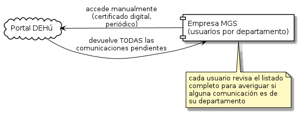
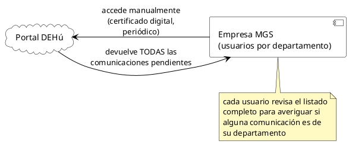
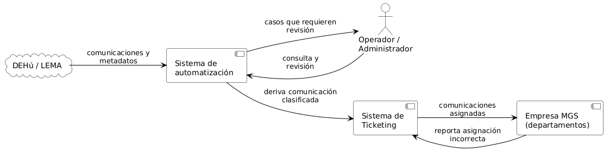
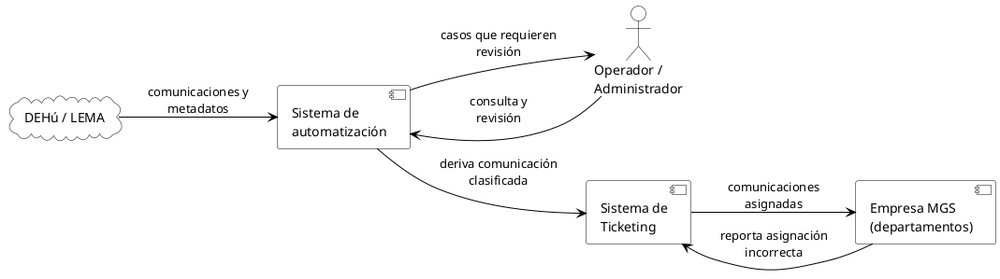

# Diagrama de contexto (alto nivel)

*Vista de contexto del sistema: qué entidades rodean la plataforma y qué intercambian con ella, sin entrar en componentes internos (para el detalle interno, ver [Diagrama de componentes](Diagrama_Componentes.md)). Se muestran dos situaciones: la actual (acceso manual) y la futura (con el sistema automatizado + IA).*

`Propuesta de proyecto.md` describe la situación actual de forma genérica ("buzones y sedes electrónicas de organismos públicos"). La puerta concreta es la **sede web de DEHú** (Dirección Electrónica Habilitada única). **Mi Carpeta Ciudadana** es otro portal (ciudadano); no es la que usan las áreas para este proceso. LEMA es la misma DEHú por servicios web, para Grandes Destinatarios (ver `Estado.md`, sección 1).

**Objetivo concreto**: sustituir el acceso manual y periódico de cada departamento a la sede web de DEHú por LEMA, clasificar cada comunicación por departamento con los metadatos de `localiza()` antes de abrir el documento, y derivarla vía ticket, sin que nadie recorra el listado completo. El OCR/LLM interpreta el documento principal después, y en este alcance solo resume las comunicaciones.

---

## Situación actual

Resumen (detalle completo en `Propuesta de proyecto.md`, sección "Descripción general"): sin sistema intermedio, usuarios de la Empresa MGS acceden manualmente y de forma periódica, revisan todas las comunicaciones pendientes y determinan una por una cuáles son de su departamento — el propio usuario hace de "filtro".

---

## Situación objetivo

El sistema sustituye el acceso manual de los usuarios de MGS al portal de DEHú por una integración automatizada mediante LEMA. Las comunicaciones se reciben y clasifican antes de ser derivadas al departamento correspondiente a través del Sistema de Ticketing. Los casos que requieren intervención humana quedan disponibles para el Operador/Administrador mediante el sistema de automatización.

### Elementos

- **DEHú / LEMA**: fuente externa de las notificaciones y comunicaciones electrónicas. En la situación objetivo, el acceso se realiza de forma automatizada mediante los servicios web de LEMA para Grandes Destinatarios.
- **Sistema de automatización**: sistema objeto del TFM. Centraliza la recepción y el tratamiento de las comunicaciones, determina el departamento destinatario y coordina su posterior derivación.
- **Sistema de Ticketing**: sistema corporativo ya existente en MGS y externo al sistema desarrollado. Constituye el canal principal mediante el que las comunicaciones clasificadas se derivan a los departamentos.
- **Empresa MGS**: representa los departamentos internos destinatarios de las comunicaciones. A diferencia de la situación actual, dejan de revisar directamente el listado completo de DEHú y reciben a través de Ticketing las comunicaciones que les han sido asignadas.
- **Operador/Administrador**: personal interno que utiliza el sistema para consultar los registros y gestionar los casos que requieren intervención humana.

